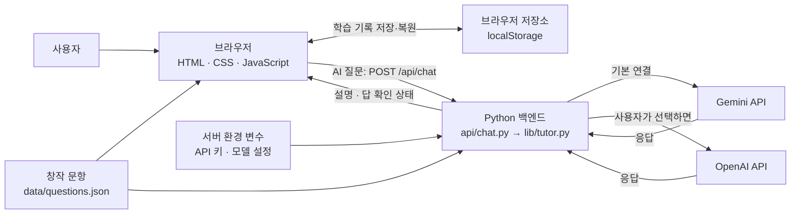
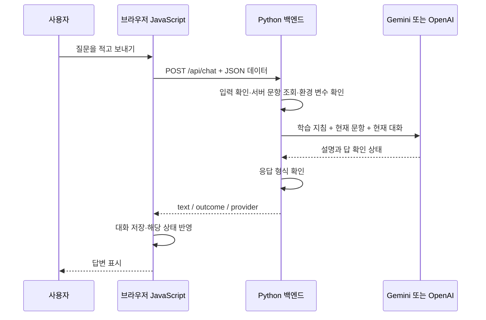

# 실기 한 걸음

**정보처리산업기사 실기를 작은 질문으로 배우고, 막힌 부분을 AI에게 물어보는 웹 학습실입니다.**

대상은 긴 설명을 읽는 데 부담을 느끼거나, 문제를 풀다가 특정 개념에서 막히는 실기 준비생입니다. 먼저 짧은 질문에 답하고, 힌트와 해설을 확인한 뒤, 헷갈리는 부분을 Gemini에게 질문할 수 있습니다.

**현재 상태:** 화면·학습 기능·Python API 코드는 구현되어 있고 로컬 검증을 마쳤습니다. **실제 API 키를 사용한 모델 응답, GitHub 업로드, Vercel 공개 배포는 아직 완료하지 않았습니다.**

| 항목 | 내용 |
| --- | --- |
| 서비스명 | 실기 한 걸음 |
| 제공하는 학습 과정 | 정보처리산업기사 실기 |
| 학습 자료 | 창작 문항 391개: 작은 질문 319개 + 연결 문제 72개 |
| 구성 | 9개 학습 영역, 89개 수업, 메뉴로 이동하는 5개 섹션 |
| 프론트엔드 | 순수 HTML / CSS / JavaScript |
| 백엔드 | Python, Vercel Serverless Functions 형식 |
| 기본 AI | Gemini API |
| 추가 AI | OpenAI API |
| 기록 저장 | 사용자의 브라우저 내부 저장소 `localStorage` |
| GitHub | [N_Project_A1-3 저장소](https://github.com/larklaon/N_Project_A1-3) — 원격 주소만 설정된 상태, 코드 업로드는 미완료 |
| 공개 배포 URL | **미배포** — 배포 후 실제 Vercel URL을 여기에 기록 |

## README를 읽는 순서

구조를 이해하려면 **1 → 2 → 3 → 4**, 직접 실행하려면 **7 → 8**, 과제를 발표하려면 **12 → 13**을 읽으세요.

1. [전체 구조: 어디서 무엇이 실행되는가](#1-전체-구조-어디서-무엇이-실행되는가)
2. [폴더와 파일: 각각 무슨 일을 하는가](#2-폴더와-파일-각각-무슨-일을-하는가)
3. [화면 구성과 사용자 경험](#3-화면-구성과-사용자-경험)
4. [버튼을 눌렀을 때의 실제 처리 과정](#4-버튼을-눌렀을-때의-실제-처리-과정)
5. [학습 데이터는 어떻게 구성되어 있는가](#5-학습-데이터는-어떻게-구성되어-있는가)
6. [무엇을 저장하고 어디에 저장하는가](#6-무엇을-저장하고-어디에-저장하는가)
7. [로컬에서 실행하기](#7-로컬에서-실행하기)
8. [Gemini 연결과 환경 변수 설정](#8-gemini-연결과-환경-변수-설정)
9. [오류가 나면 어디부터 확인하는가](#9-오류가-나면-어디부터-확인하는가)
10. [GitHub와 Vercel에 배포하기](#10-github와-vercel에-배포하기)
11. [수정하거나 기능을 추가하는 방법](#11-수정하거나-기능을-추가하는-방법)
12. [검증 결과와 과제 제출 상태](#12-검증-결과와-과제-제출-상태)
13. [타인에게 설명할 때 사용할 발표문과 질문 답변](#13-타인에게-설명할-때-사용할-발표문과-질문-답변)
14. [용어 정리와 참고 문서](#14-용어-정리와-참고-문서)

## 1. 전체 구조: 어디서 무엇이 실행되는가

이 서비스는 **사용자의 브라우저**, **우리 서비스의 Python 서버**, **외부 AI 서비스**가 역할을 나누어 실행합니다.



도식이 표시되지 않는 뷰어에서는 아래 문장으로 이해하면 됩니다.

> 브라우저가 학습 화면을 보여줍니다. 일반 단답 확인과 기록 저장은 브라우저에서 처리합니다. AI 질문만 Python 서버로 보내고, 서버가 키를 사용해 Gemini 또는 OpenAI에 요청합니다. AI 응답은 다시 브라우저로 돌아와 화면에 표시됩니다.

### HTML, CSS, JavaScript, Python의 역할

| 기술 | 쉬운 설명 | 이 프로젝트에서 하는 일 |
| --- | --- | --- |
| HTML | 화면의 기본 뼈대 | 메뉴, 본문 영역, 페이지 제목, CSS/JS 연결을 정의 |
| CSS | 화면의 모양과 배치 | 색상, 글자 크기, 카드, 모바일에서의 한 열 배치 적용 |
| JavaScript | 사용자 행동에 반응하는 동작 | 문항 불러오기, 메뉴 이동, 단답 비교, 저장, AI 요청, 결과 표시 |
| Python | 서버에서 처리하는 작업 | 입력 검증, 신뢰할 문항 찾기, 키 읽기, 외부 AI 호출, 응답 검증 |

`index.html`에는 모든 학습 화면이 처음부터 작성되어 있지는 않습니다. 메뉴와 본문을 담을 자리를 만들고, **`js/app.js`가 선택한 메뉴에 맞는 내용을 본문 안에 생성**합니다.

이것이 이 프로젝트의 ‘바닐라 구현’입니다. React나 Vue 없이 브라우저의 기본 기능을 사용합니다.

## 2. 폴더와 파일: 각각 무슨 일을 하는가

```text
N_Project_A1-3/
├── index.html                     웹페이지의 시작점
├── css/
│   └── styles.css                 화면 디자인과 반응형 규칙
├── js/
│   ├── config.js                  과정·영역·AI 제공자 설정
│   ├── app.js                     화면과 학습 기능을 움직이는 코드
│   └── tutor.js                   단답 비교와 프론트의 AI 요청
├── data/
│   └── questions.json             창작 문항·답·힌트·해설
├── images/
│   └── favicon.svg                브라우저 탭 아이콘
├── api/
│   └── chat.py                    /api/chat 요청을 받는 Python 함수
├── lib/
│   └── tutor.py                   입력 검증·학습 지침·AI 어댑터
├── scripts/
│   ├── dev_server.py              로컬에서 화면과 API를 함께 실행
│   └── import_original_drills.py  원본 창작 JSON을 읽어 허용 필드만 추출
├── tests/
│   ├── tutor.test.mjs             JavaScript 동작 자동 검증
│   └── test_api.py                Python API 자동 검증
├── docs/
│   ├── service-plan.md            서비스 기획서
│   ├── data-provenance.json       창작 데이터 추출 내역
│   ├── verification.md            검증 내용과 아직 확인하지 않은 항목
│   ├── submission-checklist.md    과제 제출 체크리스트
│   ├── ai-coding-log.md           실제 AI 코딩 대화 발췌와 작업 요약
│   └── evidence/                  데스크톱·모바일 등 화면 증빙
├── requirements.txt               서버에 필요한 Python 패키지 목록
├── package.json                   실행·테스트 명령의 별칭
├── vercel.json                    배포 함수와 응답 헤더 설정
├── .env.example                   키 값이 비어 있는 설정 예시
├── .gitignore                     Git에 올리지 않을 파일 규칙
├── .vercelignore                  배포에서 제외할 개발용 파일 규칙
└── README.md                      이 설명서
```

직접 실행하면 `.venv/`와 `.env`도 생깁니다. 둘 다 Git에 올리지 않습니다.

### 우선 알아둘 핵심 파일 7개

| 파일 | 이 파일이 없으면? | 내부의 주요 작업 |
| --- | --- | --- |
| `index.html` | 웹페이지의 출발점과 메뉴가 없어짐 | CSS와 `app.js` 연결, 본문 영역 준비 |
| `css/styles.css` | 디자인과 모바일 배치가 적용되지 않음 | 화면 폭에 따라 레이아웃 변경 |
| `js/config.js` | 과정·영역·기본 AI 설정을 알 수 없음 | Gemini 기본값, OpenAI 선택지, 문항 경로 정의 |
| `js/app.js` | 버튼과 학습 흐름이 동작하지 않음 | 화면 생성, 정답 확인, 복습, 저장, AI 응답 반영 |
| `js/tutor.js` | 단답 비교와 AI 요청 기능을 사용할 수 없음 | `matchesAnswer()`로 답 비교, `askTutor()`로 `fetch` 요청 |
| `api/chat.py` | 프론트에서 보낸 AI 질문을 서버가 받을 수 없음 | HTTP 요청·응답 처리와 오류 안내 |
| `lib/tutor.py` | 실제 외부 AI 호출을 처리할 수 없음 | 문항 ID 검증, 지침 구성, Gemini/OpenAI 호출 |

`api/chat.py`와 `lib/tutor.py`를 나눈 이유는 **요청을 받는 입구**와 **AI를 처리하는 내부 로직**을 구분하기 위해서입니다. 요청 주소는 그대로 두고, 내부 AI 제공자를 추가하거나 변경할 수 있습니다.

## 3. 화면 구성과 사용자 경험

화면은 5개 섹션으로 구성됩니다. 데스크톱에서는 왼쪽 메뉴, 모바일에서는 상단 메뉴로 이동합니다.

| 메뉴 | 사용자가 하는 행동 | 실제 동작 |
| --- | --- | --- |
| 학습 홈 | 학습 영역 선택, 이어서 시작 | 현재 문항과 실제 답 확인·복습 개수 표시 |
| 한 질문씩 배우기 | 답 입력, 힌트 확인, AI 질문 | 수업 선택, 등록 답 비교, AI 대화, 이전/다음 질문 이동 |
| 단답 연습 | 영역 선택 후 문제 풀기 | 연결 문제 72개 중 해당 범위에서 최대 12개 무작위 출제 |
| 다시 볼 질문 | 헷갈린 문항 다시 풀기 | 복습 목록 표시, 문항으로 이동, 목록에서 제거, JSON 내려받기 |
| 학습실 소개 | 자료·기록 처리 방식 확인 | 서비스 설명, 데이터 전달 안내, 학습 기록 초기화 |

### 메뉴 이동은 어떻게 구현했나?

메뉴를 누르면 주소의 끝부분이 `#home`, `#study`, `#practice`, `#review`, `#about`으로 바뀝니다. 이 부분을 **URL 해시**라고 합니다.

`js/app.js`가 `hashchange` 이벤트를 감지하고 해당 화면을 다시 그립니다. 따라서 HTML 파일은 하나지만 메뉴로 이동할 수 있는 섹션은 5개입니다.

### 모바일에서 달라지는 부분

`css/styles.css`의 `@media` 규칙이 화면 폭을 확인합니다. 폭이 줄어들면 메뉴가 상단으로 이동하고, 질문과 AI 대화 패널이 한 열로 배치됩니다. 코드 블록이 길면 블록 안에서 가로로 스크롤할 수 있습니다.

실제 화면은 [데스크톱 학습](docs/evidence/desktop-study.jpg), [모바일 학습](docs/evidence/mobile-study.jpg)에서 확인할 수 있습니다.

## 4. 버튼을 눌렀을 때의 실제 처리 과정

**‘답 확인하기’와 ‘AI 선생님에게 보내기’는 서로 다른 처리 과정입니다.** 이 부분을 이해하면 서비스의 핵심을 설명할 수 있습니다.

### A. ‘답 확인하기’: 브라우저가 등록된 답을 비교

예를 들어 현재 질문이 `int x=3;에서 x에 들어 있는 값은?`일 때 사용자가 `3`을 입력합니다.

1. `js/app.js`가 폼 제출을 감지합니다.
2. `js/tutor.js`의 `matchesAnswer()`가 입력과 문항의 `answers`를 비교합니다.
3. 맞으면 해설을 보여주고 답을 확인한 문항 목록에 추가합니다.
4. 다르면 힌트를 보여주고 복습 목록에 추가합니다.
5. 바뀐 기록을 브라우저 저장소에 저장합니다.

**이 과정에서는 Gemini나 OpenAI를 호출하지 않습니다.** 등록된 답 비교이므로 API 키가 없어도 사용할 수 있습니다.

용어 문제는 등록 동의어와 대소문자·공백 등의 차이를 처리합니다. 코드 출력 문제는 내부 공백·줄바꿈·대소문자를 구별합니다. 앞뒤 공백과 일부 한국어 종결 표현도 처리하지만, 자유로운 문장 전체의 의미를 이해해서 채점하는 기능은 아닙니다.

### B. ‘AI 선생님에게 보내기’: Python 서버가 외부 AI 호출

사용자가 AI 입력창에 `왜 3인가요?`를 입력하고 보내기를 누릅니다.



이 요청을 보내는 실제 프론트 코드의 핵심은 다음과 같습니다. 읽기 위한 축약 예시이며, 구현에는 취소·타임아웃·오류 처리도 포함되어 있습니다.

```js
fetch('/api/chat', {
  method: 'POST',
  headers: { 'Content-Type': 'application/json' },
  body: JSON.stringify({
    courseId: course.id,
    provider: 'gemini',
    questionId: question.id,
    messages: [{ role: 'user', content: '왜 3인가요?' }],
  }),
});
```

`fetch`는 JavaScript가 서버로 요청을 보내는 기능입니다. `/api/chat`은 요청을 받을 주소, `POST`는 입력 데이터를 보내는 요청 방식, `JSON.stringify`는 JavaScript 데이터를 전송용 JSON 문자열로 바꾸는 기능입니다.

#### 서버로 보내는 데이터 예시

```json
{
  "courseId": "industry-practical",
  "provider": "gemini",
  "questionId": "MP-C-01-01",
  "messages": [
    { "role": "user", "content": "왜 3인가요?" }
  ]
}
```

| 필드 | 의미 |
| --- | --- |
| `courseId` | 어느 학습 과정인지. 현재는 정보처리산업기사 실기 하나 |
| `provider` | 어느 AI를 쓸지. 기본 `gemini`, 선택 `openai` |
| `questionId` | 현재 질문의 고유 번호 |
| `messages` | 현재 질문에서 주고받은 대화. 전송 시 최대 12개 메시지 |

프론트는 정답을 요청에 넣지 않습니다. **서버가 `questionId`로 자신의 문항 데이터에서 정답·힌트·해설을 찾아 사용합니다.** 클라이언트가 임의로 붙인 정답 필드는 판정 근거로 사용하지 않습니다.

#### 서버 내부에서 하는 일

`api/chat.py`는 요청 형식과 크기를 확인합니다. 이후 `lib/tutor.py`에서 아래 순서로 처리합니다.

1. 존재하는 과정·문항·제공자인지 확인합니다.
2. 대화가 1~12개이고, 각 메시지가 비어 있지 않은 2,000자 이하인지 확인합니다.
3. 외부 요청 활성화 여부와 제공자 키를 확인합니다.
4. 현재 문항과 ‘짧게 설명하기, 힌트 요청에는 답부터 공개하지 않기’ 등의 학습 지침을 준비합니다.
5. `call_gemini()` 또는 `call_openai()`를 실행합니다.
6. 응답의 설명과 상태가 유효한지 확인하고 프론트에 반환합니다.

#### 응답 형태 예시

아래는 **응답 형식을 설명하는 예시**입니다. 실제 AI 호출 성공 증빙은 아닙니다.

```json
{
  "text": "맞았어요. =는 오른쪽 값을 왼쪽 변수에 넣는 연산자예요.",
  "outcome": "correct",
  "provider": "gemini"
}
```

| `outcome` 값 | 의미 | 화면·기록 처리 |
| --- | --- | --- |
| `correct` | AI가 현재 질문 전체의 답을 확인 | 답을 확인한 문항에 추가 |
| `retry` | 오답 또는 부분 답으로 판단 | 다시 볼 질문에 추가 |
| `explain` | 힌트·설명·질문에 대한 응답 | 설명 표시, 정답 개수는 증가하지 않음 |

프론트의 `sendTutor()`는 성공한 응답만 대화에 저장합니다. 실패하면 입력 초안·현재 질문·기존 대화를 보존합니다. 성공해도 다음 질문으로 자동 이동하지는 않으며, 사용자가 ‘다음 질문’을 눌러 이동합니다.

### C. 답 확인 개수는 무엇을 의미하나?

한 문항을 여러 번 맞혀도 답 확인 개수는 한 번만 늘어납니다. 이미 확인한 문항을 나중에 틀렸다고 이전 확인 이력을 지우지는 않습니다. 따라서 이 숫자는 **한 번 이상 답을 확인한 문항 수**이며, 현재 실력이나 숙달도를 보장하는 점수가 아닙니다.

힌트를 보거나 질문을 넘기는 것만으로 답 확인 개수가 늘지 않습니다. 정답을 먼저 본 문제는 복습 목록에 추가하고, 단답 연습에서는 정답으로 집계하지 않습니다.

## 5. 학습 데이터는 어떻게 구성되어 있는가

`data/questions.json`은 문제집 역할을 합니다. 문항 한 개마다 질문·허용 답·힌트·해설·영역·수업 정보를 가지고 있습니다.

```json
{
  "id": "MP-C-01-01",
  "topic": "c",
  "prompt": "int x=3;에서 x에 들어 있는 값은?",
  "answers": ["3"],
  "code": "",
  "explanation": "=는 오른쪽 값을 왼쪽 변수에 넣는다.",
  "hint": "=는 오른쪽 값을 왼쪽 변수에 넣는다.",
  "mode": "output",
  "kind": "micro",
  "unitId": "U-C-01",
  "unitTitle": "값 넣기와 증가"
}
```

| 필드 | 역할 |
| --- | --- |
| `id` | 문항 고유 번호. 학습 기록과 API 요청을 연결하는 기준 |
| `topic` | 학습 영역. 예: `c`, `sql`, `network` |
| `prompt`, `code` | 화면에 표시할 질문과 코드 |
| `answers` | 허용하는 답의 목록. 동의어가 있으면 여러 개 등록 |
| `hint`, `explanation` | 힌트와 해설 |
| `mode` | 코드 출력 비교인지 용어 비교인지 구분 |
| `kind` | `micro`는 작은 질문, `checkpoint`는 연결 문제 |
| `unitId`, `unitTitle` | 어느 수업에 들어가는 질문인지 |
| `supplement` | 일부 문항의 범위 보완 여부 |

브라우저가 시작되면 `app.js`가 이 JSON을 읽고 같은 `unitId`의 문항을 수업으로 묶습니다. 수업 안에서는 작은 질문을 먼저, 연결 문제를 뒤에 배치합니다. 단답 연습은 연결 문제만 사용합니다.

이 데이터에는 답·해설도 들어 있어 브라우저에서 읽을 수 있습니다. 개인 학습용 자료이며, 답을 기술적으로 숨기는 시험 시스템은 아닙니다. 서버의 정답 재조회는 AI 요청에 사용자가 붙인 임의의 답을 신뢰하지 않기 위한 처리입니다.

### 사용한 자료와 제외한 자료

원본 개인 학습지에서 `micro`와 `checkpoint`로 표시된 **창작 문항만 추출**했습니다. 원본 데이터 생성 스크립트를 실행하거나 원본 파일을 수정하지 않았습니다.

| 포함 | 제외 |
| --- | --- |
| 창작 질문·코드·허용 답·힌트·해설·수업 정보 | 기출 원문·출판사 PDF·자료 색인·기출 빈도 통계 |
| 새 서비스 사용 후 생기는 브라우저 기록 | 원본 앱의 개인 대화·성적·진도·로그인 정보 |

문항의 기출 연결 필드인 `refs`, `sources`, `source_paths` 등도 제외했습니다. 추출 내역은 [데이터 출처 기록](docs/data-provenance.json)에 있습니다.

## 6. 무엇을 저장하고 어디에 저장하는가

현재 별도의 사용자 데이터베이스나 회원가입 기능은 없습니다. 학습 기록은 **이 웹사이트를 여는 브라우저 안**에 저장됩니다.

| 기록 | 저장 위치 | 새로고침 후 |
| --- | --- | --- |
| 현재 학습 문항 | `localStorage` | 복원 |
| 한 질문씩 배우기의 답 초안 | `localStorage` | 복원 |
| AI 입력 초안·성공한 문항별 대화 | `localStorage` | 복원 |
| 답 확인 문항·복습 목록·단답 연습 문항별 최근 결과 | `localStorage` | 복원 |
| 선택한 AI 제공자 | `localStorage` | 복원 |
| 진행 중인 단답 연습의 문제 순서·현재 위치·답 초안·회차 결과 | JavaScript 메모리 | 해당 연습 진행 상태는 사라짐 |
| API 키 | 서버 환경 변수 | 브라우저에 저장하지 않음 |

저장 키는 `practical-one-step-v1`입니다. 원본 개인 학습지의 저장 키를 공유하지 않습니다.

주소·브라우저·기기를 바꾸면 같은 기록이 자동으로 따라오지 않습니다. 특히 로컬 주소와 Vercel 주소는 저장 영역이 다릅니다. 기록 삭제는 ‘학습실 소개 → 이 학습실의 저장 기록 관리 → 초기화 확인’으로 처리합니다.

AI 질문을 보낼 때는 현재 문항의 정보와 해당 질문의 최근 대화를 선택한 AI 제공자에게 전달합니다. 다른 문항의 대화나 원본 자료실 전체를 보내지는 않습니다. 저장한 전체 대화를 별도의 자체 서버 데이터베이스에 동기화하는 기능도 없습니다.

## 7. 로컬에서 실행하기

**로컬 실행은 내 컴퓨터에서만 사이트를 열어 확인하는 것**입니다. 다른 사람이 인터넷에서 접속하는 공개 배포와 다릅니다.

아래 명령은 현재 개발 환경인 **macOS 터미널 기준**입니다. Python 3가 필요하고, 자동 테스트에는 Node.js 22 이상이 필요합니다. 학습 화면을 실행하는 데 Node.js가 필수인 것은 아닙니다.

### 처음 한 번 준비

현재 작업 환경에서는 다음 명령으로 프로젝트 폴더로 이동합니다. 다른 컴퓨터에서는 자신이 이 프로젝트를 저장한 경로로 바꿉니다.

```sh
cd /Users/yeongjun/Documents/GitHub/N_Project_A1-3
```

이후 한 줄씩 실행합니다.

```sh
python3 -m venv .venv
.venv/bin/python -m pip install -r requirements.txt
cp .env.example .env
```

| 명령 | 하는 일 |
| --- | --- |
| `python3 -m venv .venv` | 이 프로젝트의 Python 패키지를 관리할 가상 환경 생성 |
| `... pip install -r requirements.txt` | 외부 HTTP 요청용 패키지 `requests`와 필요한 의존성 설치 |
| `cp .env.example .env` | 실제 사용할 로컬 설정 파일 생성. 처음 한 번만 실행 |

이미 `.env`를 만들어 키를 입력했다면 `cp` 명령을 다시 실행하지 않습니다. 기존 설정을 덮어쓸 수 있습니다.

### 실행할 때마다

프로젝트 폴더에서 다음 명령을 실행합니다.

```sh
.venv/bin/python scripts/dev_server.py
```

터미널에 `Local: http://127.0.0.1:43125`가 출력되면 브라우저에서 [로컬 학습실](http://127.0.0.1:43125)을 엽니다. 이 링크는 서버가 실행 중인 내 컴퓨터에서만 동작합니다.

터미널을 계속 열어두어야 합니다. 종료할 때는 **Control + C**, 다시 실행할 때는 위 명령을 다시 입력합니다.

가상 환경 준비 후에는 `npm run dev`로도 같은 서버를 실행할 수 있습니다. `package.json`은 이 명령의 별칭을 정의하며 프론트 프레임워크를 설치하는 파일은 아닙니다. JavaScript 실행에 필요한 별도 npm 패키지는 없습니다.

### API 키가 없어도 확인할 수 있는 것

문항·수업 선택, 단답 확인, 힌트·해설, 무작위 연습, 복습, 브라우저 저장은 사용할 수 있습니다. AI 질문에는 ‘연결을 준비하고 있어요’ 안내가 표시됩니다. 가짜 AI 답변으로 대신하지 않습니다.

`index.html`을 더블클릭해 파일 주소로 여는 대신 서버를 실행합니다. 그래야 `/data/questions.json`과 `/api/chat` 요청을 정상적으로 처리할 수 있습니다.

## 8. Gemini 연결과 환경 변수 설정

**API 키는 서버가 외부 AI 서비스를 이용할 권한을 확인받기 위한 값**입니다. 이 서비스는 ChatGPT나 Google 계정의 웹 로그인 대신 서버 API 키를 사용합니다.

### Gemini를 연결하는 순서

1. [Google AI Studio](https://aistudio.google.com/)에서 본인 프로젝트용 Gemini API 키를 준비합니다.
2. 프로젝트의 `.env` 파일을 편집기로 엽니다.
3. `GEMINI_API_KEY=` 뒤에 키를 넣고 `AI_ENABLED=true`로 바꿉니다.
4. `GEMINI_MODEL`에는 본인 프로젝트에서 사용할 수 있는 모델 ID를 지정합니다.
5. 파일을 저장하고 로컬 서버를 종료한 뒤 다시 실행합니다.
6. ‘한 질문씩 배우기’에서 AI 연결이 Gemini인지 확인하고 질문을 보냅니다.

설정 형태는 다음과 같습니다. **아래 한글 안내 부분은 실제 키로 교체해야 합니다. 이 예시 자체는 유효한 키가 아닙니다.**

```dotenv
AI_ENABLED=true
DEFAULT_AI_PROVIDER=gemini
GEMINI_API_KEY=발급받은_키를_로컬_파일에만_입력
GEMINI_MODEL=gemini-3.8-flash
```

`gemini-3.8-flash`는 현재 코드와 예시 파일에 지정된 모델 ID입니다. 실제 접근 가능한 모델과 사용 한도는 본인 API 프로젝트에서 확인합니다.

### 설정 항목 전체

| 변수 | 기본/예시 값 | 설명 |
| --- | --- | --- |
| `AI_ENABLED` | `false` | `true`일 때만 실제 외부 AI 요청 허용 |
| `DEFAULT_AI_PROVIDER` | `gemini` | 요청에서 제공자를 생략한 경우 서버가 사용할 기본 AI |
| `GEMINI_API_KEY` | 빈 값 | Gemini 인증 키 |
| `GEMINI_MODEL` | `gemini-3.8-flash` | Gemini 모델 ID |
| `OPENAI_API_KEY` | 빈 값 | 선택 기능인 OpenAI 인증 키 |
| `OPENAI_MODEL` | `gpt-4o-mini` | OpenAI 모델 ID |

화면에서 보내는 기본 제공자는 `js/config.js`의 `tutorConfig.defaultProvider`입니다. 사용자가 화면에서 다른 제공자를 선택하면 선택값이 저장됩니다. 서버의 `DEFAULT_AI_PROVIDER`는 요청에 선택값이 없는 경우의 기본값입니다.

OpenAI도 사용하려면 서버의 `OPENAI_API_KEY`와 모델을 설정하고 화면에서 OpenAI를 선택합니다. OpenAI 키를 설정하지 않아도 Gemini 사용에는 영향을 주지 않습니다.

### 키를 환경 변수로 관리하는 이유

HTML·CSS·JavaScript와 공개 JSON은 브라우저로 전달됩니다. 그 안에 키를 적으면 다른 사람이 읽을 수 있습니다. 따라서 키는 **Python 서버에서만 읽도록** 배치합니다.

로컬에서는 `.env`, Vercel에서는 프로젝트 환경 변수 설정에 키를 넣습니다. `.env.example`은 변수 이름과 빈 키를 공유하기 위한 파일입니다. `.gitignore`가 `.env`를 Git에서 제외하지만, 이미 커밋한 키를 지워주는 기능은 아닙니다. 키가 노출되었다면 제공자에서 폐기·재발급하고 노출된 파일과 커밋도 정리해야 합니다.

키·계정 화면은 제출 스크린샷에 넣지 않습니다. 정상 AI 응답 증빙에는 학습 질문과 답변 화면을 사용합니다.

## 9. 오류가 나면 어디부터 확인하는가

먼저 **화면 문제인지, Python 서버 문제인지, 외부 AI 문제인지** 구분합니다.

| 증상 | 먼저 확인할 것 | 처리 방향 |
| --- | --- | --- |
| 사이트가 열리지 않음 | 서버 터미널이 실행 중인지 | 로컬 서버 실행, 출력된 주소로 접속 |
| `No module named requests` | `.venv`의 Python을 사용했는지 | 가상 환경 Python으로 설치·실행 |
| 포트가 이미 사용 중이라는 메시지 | 같은 서버를 중복 실행했는지 | 기존 서버 종료 또는 `--port 43126`으로 실행 |
| 문제 자료를 불러오지 못함 | 파일을 직접 열었는지, JSON 경로가 있는지 | 서버 주소로 열고 개발자 도구의 데이터 요청 확인 |
| 빈 답 안내 | 입력이 공백뿐인지 | 답이나 질문 입력 |
| AI 연결 준비 안내 | 활성화 플래그·선택한 제공자의 키 | `.env` 수정 후 서버 재시작; Vercel에서는 환경 변수 확인 후 재배포 |
| AI 연결 설정 확인 안내 | 키 권한, 모델 접근 여부 | 선택한 제공자의 API 설정 확인 |
| 이용 한도 안내 | 제공자의 사용량·쿼터 | 한도 확인 후 잠시 뒤 다시 요청 |
| 응답 지연 안내 | 네트워크·AI 지연 | 입력을 유지한 채 다시 요청 |
| 답변 형식 안내 | 응답이 JSON과 예상 상태를 따르는지 | 제공자 어댑터·학습 지침·응답 검증 확인 |
| 기록이 이어지지 않음 | 같은 브라우저와 주소인지 | 저장 차단, 사이트 데이터 삭제, 로컬/배포 주소 차이 확인 |

프론트의 대기 제한은 25초입니다. 서버의 외부 HTTP 요청에는 연결 5초·응답 대기 20초 타임아웃을 지정합니다. 서버의 두 타임아웃은 HTTP 요청 단계의 제한이며 전체 동작 시간이 항상 정확히 25초라는 뜻은 아닙니다. 화면에서 ‘멈추기’를 누르면 프론트 요청 대기를 취소합니다. **이미 서버나 AI에서 시작한 처리·과금까지 반드시 취소된다고 보장하지는 않습니다.**

요청 중에는 중복 전송을 막고, 자동 재시도로 유료 요청을 반복하지 않습니다. 현재 서버 전체의 분산 요청 제한이나 사용자별 과금 관리 기능은 없으므로, 공개 운영 전 제공자 측 사용량 상한도 설정해야 합니다.

### 개발자 도구에서 AI 요청 확인

브라우저 개발자 도구의 **Network** 탭을 열고 질문을 보낸 뒤 `chat` 요청을 찾습니다. Request Payload에는 문항 ID·제공자·대화가, Response에는 답변 또는 안내 오류가 보여야 합니다. API 키는 브라우저 요청에 포함하지 않습니다.

대표 상태 코드는 `400` 입력 오류, `429` 이용 한도, `503` 비활성·키/접근 설정 문제, `502` 외부 서비스/응답 문제, `504` 서버 타임아웃입니다. 주소를 직접 열어 `GET /api/chat` 요청을 보내면 `405` 안내가 나오며, AI 질문은 입력창에서 `POST`로 보내야 합니다.

## 10. GitHub와 Vercel에 배포하기

### 로컬과 배포 환경의 차이

| 항목 | 내 컴퓨터에서 실행 | Vercel 배포 후 |
| --- | --- | --- |
| 접속 주소 | `127.0.0.1:43125` | 발급된 `https://…vercel.app` 주소 |
| 누가 접속하나 | 같은 컴퓨터에서 접속 | 공개 설정된 URL에 방문하는 사용자 |
| 서버 실행 담당 | 내가 실행한 `dev_server.py` | Vercel의 Python 함수 실행 환경 |
| 키 설정 | 로컬 `.env` | Vercel 프로젝트 환경 변수 |
| 프론트 파일 | 내 프로젝트 파일 | 업로드·배포된 파일 |
| 학습 기록 | 로컬 주소의 브라우저 저장소 | 배포 주소의 브라우저 저장소 |
| 수정 반영 | 파일 저장, 필요한 경우 새로고침/서버 재시작 | 변경 코드를 올리고 새 배포 생성 |

### Vercel Serverless Functions는 무엇인가?

개발자가 공개 서버를 직접 켜 두고 관리하는 대신, 플랫폼이 요청에 맞춰 함수를 실행하는 방식입니다. 이 프로젝트에서는 **AI 질문이 `/api/chat`에 도착하면 `api/chat.py`가 처리하고 JSON 응답을 돌려줍니다.**

‘서버리스’에도 서버는 있습니다. 서버 운영을 플랫폼이 맡는다는 의미입니다. 브라우저의 학습 화면과 서버의 AI 처리 역할은 그대로 나뉩니다.

### GitHub에 코드 올리기

현재 저장소에는 원격 주소가 설정되어 있지만 코드 커밋·업로드는 아직 하지 않았습니다. 아래는 사용자가 수행할 절차입니다.

프로젝트 폴더에서 파일과 제외 규칙을 먼저 확인합니다.

```sh
git status
git check-ignore .env .venv
```

`.env`와 `.venv`가 제외되는지 확인한 뒤 다음 명령을 실행합니다.

```sh
git add .
git commit -m "학습 웹 서비스와 Gemini Python API 구현"
git push -u origin main
```

Git 사용자 정보나 GitHub 인증이 설정되어 있지 않다면 먼저 설정해야 합니다. 원격 변경으로 푸시가 거부되면 원인을 확인하며, 강제 푸시로 덮어쓰지 않습니다.

### Vercel에서 배포

1. Vercel에서 GitHub 저장소 `N_Project_A1-3`를 Import합니다.
2. Root Directory는 이 README와 `index.html`이 있는 저장소 최상위로 둡니다.
3. Framework Preset은 **Other**를 선택합니다. 별도 빌드 명령은 사용하지 않고, Output Directory는 기본값으로 둡니다. 현재 프로젝트에는 `dist/`를 만드는 과정이 없습니다.
4. 프로젝트 환경 변수에 `AI_ENABLED=true`, `GEMINI_API_KEY`, `GEMINI_MODEL`, `DEFAULT_AI_PROVIDER=gemini`를 설정합니다. 필요한 경우 OpenAI 변수도 추가합니다.
5. 배포 후 발급된 실제 URL을 엽니다.
6. 5개 메뉴와 모바일 화면, 정상 AI 응답·빈 입력·실패 안내를 확인합니다.
7. 정상 동작을 확인한 URL을 README 맨 위와 제출 자료에 기록합니다.

로컬 `.env`가 Vercel의 환경 변수 설정을 대신하지 않습니다. 배포 환경에서 값을 추가·변경했다면 해당 값이 적용된 새 배포로 확인해야 합니다.

`requirements.txt`는 Python 패키지 설치 목록입니다. `vercel.json`에는 함수 실행 한도 30초와 개발용 파일 제외, 브라우저 응답 헤더 설정이 있습니다. `data/questions.json`과 `lib/`는 서버에서도 필요하므로 배포에서 제외하지 않습니다.

배포 후 문제가 생기면 **화면의 Network 응답 → Vercel 함수 로그 → 제공자 설정**을 확인하고, 해당 코드를 수정해 커밋·푸시한 뒤 새 배포에서 다시 검증합니다. Git 연동 배포가 설정되어 있으면 코드 푸시로 새 배포가 생성됩니다.

## 11. 수정하거나 기능을 추가하는 방법

| 바꾸고 싶은 것 | 먼저 볼 파일 | 함께 확인할 것 |
| --- | --- | --- |
| 색상·글자·카드·모바일 배치 | `css/styles.css` | 데스크톱과 모바일 화면 |
| 메뉴·화면 문구·학습 흐름 | `index.html`, `js/app.js` | 해시 이동과 저장 상태 |
| 학습 영역·기본 AI·API 주소 | `js/config.js` | 서버의 과정/제공자 설정 |
| 문항·답·힌트·해설 | `data/questions.json` | 고유 ID, 수업 ID, 영역 ID |
| 단답 비교 방식 | `js/tutor.js` | 코드 출력의 공백·대소문자 보존 |
| AI 말투·설명 기준·판정 규칙 | `lib/tutor.py`의 `instructions()` | 실제 AI 응답과 `outcome` |
| 새로운 AI 제공자 | `lib/tutor.py`의 `PROVIDERS`와 `js/config.js` | 키·모델·요청 방식·응답 형식 |
| API 요청 크기·HTTP 오류 처리 | `api/chat.py` | 정상 요청과 잘못된 요청 |
| 배포 함수 설정 | `vercel.json` | 필요한 데이터와 모듈이 포함되는지 |

### 다른 AI를 추가하려면

어댑터는 **각 AI의 다른 요청·응답 형식을 우리 서비스의 공통 형식으로 맞추는 함수**입니다. Gemini는 `call_gemini()`, OpenAI는 `call_openai()`가 이 역할을 합니다.

새 제공자를 추가할 때는 서버에 호출 함수와 키 설정을 만들고 `PROVIDERS`에 등록합니다. 프론트의 제공자 선택 목록도 추가합니다. 서버는 최종적으로 `text`, `outcome`, `provider`를 반환하므로 학습 화면 전체를 다시 작성할 필요는 없습니다.

### 다른 학습 과정으로 확장하려면

현재 제공하는 과정은 정보처리산업기사 실기 하나입니다. 데이터와 실행 로직을 분리했으므로 다른 창작 문항 파일, 서버 `COURSES` 설정, 프론트 과정·영역 설정을 추가하는 방향으로 확장할 수 있습니다. 서비스명·설명 등 정보처리산업기사에 맞춘 화면 문구도 수정해야 합니다. **지금 여러 과정을 선택하는 화면이 구현된 것은 아닙니다.**

문항 ID는 저장 기록과 연결됩니다. 질문의 의미를 완전히 바꿀 때 같은 ID를 재사용하면 이전 기록이 다른 질문에 붙을 수 있으므로 새 ID를 사용합니다. 문항 데이터를 바꿨다면 로컬 서버도 재시작하고 화면을 새로고침합니다.

## 12. 검증 결과와 과제 제출 상태

### 자동 테스트 실행

가상 환경과 패키지를 준비한 뒤 프로젝트 폴더에서 실행합니다.

```sh
npm test
```

또는 두 부분을 따로 실행할 수 있습니다.

```sh
node --test tests/tutor.test.mjs
.venv/bin/python -m unittest discover -s tests
```

현재 기록된 결과는 **JavaScript 6개 + Python 6개, 총 12개 통과**입니다. 입력 검증, 단답 비교, Gemini 기본값, 요청 취소, 타임아웃, API 오류, 응답 형식 등을 확인합니다.

외부 AI 응답은 테스트 안에서 모의 데이터로 대체합니다. 이것은 과금 없이 요청·오류 처리를 검사하기 위한 테스트이며, 실제 서비스의 가짜 AI 응답 기능이 아닙니다. 실제 모델 응답 검증은 별도로 해야 합니다.

브라우저에서는 1440×1000 데스크톱과 390×844 모바일, 메뉴 이동, 단답 확인, 복습 등록, 새로고침 복원, API 미설정 안내를 확인했습니다. 원본 자료실 파일 261개는 작업 전후 해시가 같았습니다. 자세한 내용은 [검증 기록](docs/verification.md)에 있습니다.

### 필수 제출 패키지 5종

| 제출물 | 지금 준비된 것 | 제출 전 남은 것 |
| --- | --- | --- |
| 배포된 웹 서비스 | 반응형 화면, 실제 학습 기능, Python AI API 코드 | 실제 키로 AI 응답 확인, Vercel 배포, 공개 URL 검증 |
| GitHub 저장소 | 프로젝트 폴더, 원격 저장소 주소 | 커밋과 푸시, 웹에서 코드 확인 |
| README | 서비스·구조·실행·환경 변수·배포 설명 | 실제 배포 URL과 최종 검증 상태 갱신 |
| 서비스 기획서 | [기획서](docs/service-plan.md) | 최종 구현 변경이 있다면 내용 갱신 |
| 증빙 자료 | 로컬 데스크톱/모바일 화면, [AI 코딩 대화 발췌](docs/ai-coding-log.md) | 배포 URL의 화면과 실제 AI 응답 장면 |

[제출 체크리스트](docs/submission-checklist.md)에서 완료 여부를 관리합니다. `api-not-configured.jpg`는 오류 처리 증빙이며 정상 AI 응답 증빙으로 제출하지 않습니다.

## 13. 타인에게 설명할 때 사용할 발표문과 질문 답변

### 약 1분 설명 예시

> 제가 만든 서비스는 ‘실기 한 걸음’입니다. 정보처리산업기사 실기를 준비하는 사람이 긴 해설을 읽기보다 작은 질문에 직접 답하면서 배우도록 만들었습니다.
>
> 학습 홈, 단계별 학습, 단답 연습, 복습, 서비스 소개의 5개 섹션이 있고 모바일에서도 사용할 수 있도록 반응형으로 구성했습니다. 자료는 창작 문항 391개를 사용했습니다.
>
> 화면은 HTML과 CSS로 구성하고, JavaScript가 문항 선택·단답 확인·저장·서버 요청을 처리합니다. 일반 단답은 브라우저가 등록된 답과 비교하고, AI 질문은 Python 백엔드가 Gemini API를 호출하도록 만들었습니다. OpenAI도 선택할 수 있게 제공자별 호출 로직을 분리했습니다.
>
> API 키는 프론트에 넣지 않고 서버 환경 변수로 관리합니다. 실패하면 입력과 기존 대화를 남겨 다시 시도할 수 있게 했습니다. 현재 로컬 기능과 자동 테스트 검증을 마쳤고, 실제 API 키로 응답을 확인한 뒤 Vercel에 배포하는 단계가 남아 있습니다.

실제 배포와 정상 AI 응답 검증이 끝나면 마지막 문장을 검증한 사실과 실제 URL로 바꾸면 됩니다.

### 자주 받을 수 있는 질문

| 질문 | 설명할 답 |
| --- | --- |
| HTML/CSS/JavaScript의 차이는? | HTML은 뼈대, CSS는 모양과 배치, JavaScript는 사용자 행동에 반응하는 동작입니다. |
| Python이 왜 필요한가? | 브라우저에 키를 노출하지 않고 서버에서 입력 검증과 외부 AI 요청을 처리하기 위해서입니다. |
| 답 확인도 전부 AI인가? | 일반 단답은 등록 답 비교이고, AI 대화는 힌트·예시·설명·문장형 답의 피드백입니다. |
| 버튼을 누르면 서버로 무엇이 가나? | 과정 ID, 문항 ID, 선택한 AI 제공자, 현재 문항의 최근 대화가 JSON으로 갑니다. |
| AI 응답은 어떻게 화면에 나오나? | 서버가 설명과 상태를 JSON으로 반환하면 JavaScript가 대화를 저장하고 화면을 다시 그립니다. |
| 서버리스는 서버가 없다는 뜻인가? | 플랫폼이 서버 실행과 운영을 맡는다는 뜻입니다. Python 함수는 서버에서 실행됩니다. |
| 학습 기록은 DB에 저장되나? | 현재는 브라우저의 `localStorage`에 저장합니다. 다른 기기로 자동 동기화하지 않습니다. |
| 키가 없으면 아무것도 못 쓰나? | 단답 학습·힌트·해설·복습은 쓸 수 있고, AI 질문에는 연결 준비 안내가 나옵니다. |
| 다른 AI로 바꿀 수 있나? | 제공자별 어댑터가 공통 응답 형식을 반환하므로 화면 전체를 바꾸지 않고 추가할 수 있습니다. |
| AI가 틀리면 어떻게 하나? | 형식 검증은 하지만 내용이 항상 맞는다고 보장하지 않습니다. 공식 성적·숙달 판정으로 쓰지 않고 학습 피드백으로 제공합니다. |
| 무엇을 직접 검증했나? | 12개 자동 테스트와 두 화면 크기, 실제 단답 처리·저장·복습·API 미설정 오류를 확인했습니다. 실제 모델 응답과 배포 검증은 아직 남았습니다. |
| 오류를 어떻게 찾고 고치나? | 브라우저 요청·응답과 서버 로그를 보고 화면, Python, 외부 AI 중 어느 단계에서 실패했는지 찾아 해당 파일을 수정합니다. |

## 14. 용어 정리와 참고 문서

| 용어 | 이 프로젝트에서의 뜻 |
| --- | --- |
| 프론트엔드 | 브라우저에서 보이는 화면과 그 동작 |
| 백엔드 | Python 서버에서 실행되는 처리 코드 |
| API | 프로그램끼리 정해진 형식으로 요청·응답을 주고받는 통로 |
| 엔드포인트 | 특정 요청을 받을 주소. 여기서는 `/api/chat` |
| JSON | 이름과 값으로 데이터를 표현하는 전송·저장 형식 |
| 환경 변수 | 실행 환경에 넣는 설정값. 코드와 키를 분리할 때 사용 |
| 모델 | 실제 설명을 생성하는 AI의 이름. 제공자와 별도로 설정 |
| 어댑터 | 제공자마다 다른 API 형식을 공통 응답으로 맞추는 코드 |
| 로컬 | 내 컴퓨터에서 실행하는 환경 |
| 배포 | 다른 사용자가 접속할 수 있도록 실행 환경에 코드를 올리는 과정 |
| 커밋 | Git에 변경 이력을 한 묶음으로 기록하는 것 |
| 푸시 | 로컬 커밋을 GitHub 원격 저장소에 올리는 것 |
| 타임아웃 | 너무 오래 기다린 요청의 대기를 끝내는 처리 |
| 모의 응답 | 자동 테스트에서 외부 요청 대신 사용하는 검증용 데이터 |

API 요청 형식은 [Gemini 구조화 응답 공식 문서](https://ai.google.dev/gemini-api/docs/generate-content/structured-output)와 [OpenAI 구조화 응답 공식 문서](https://developers.openai.com/api/docs/guides/structured-outputs)를 참고했습니다. Python 배포 방식은 [Vercel Python 런타임 문서](https://vercel.com/docs/functions/runtimes/python)를 참고합니다.
